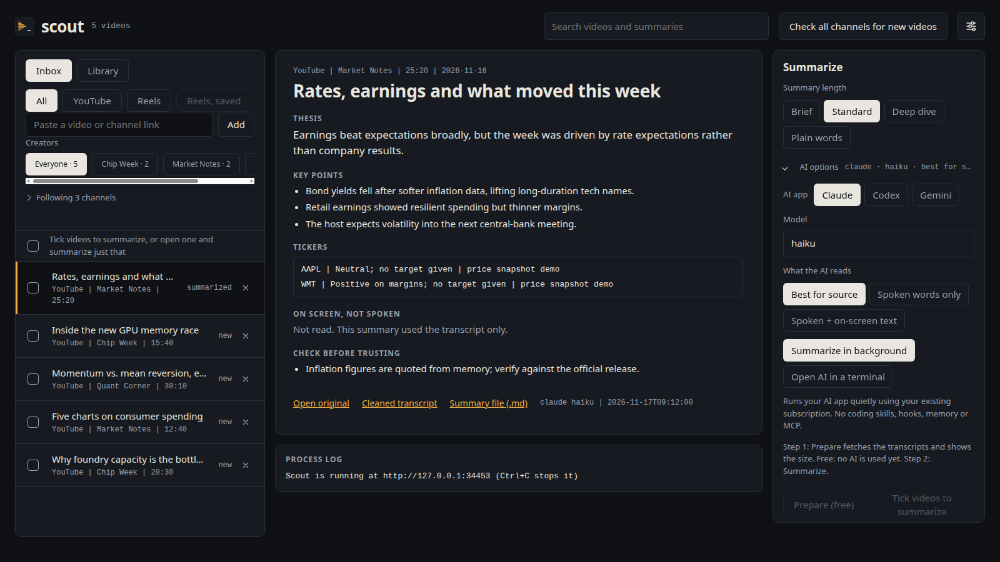
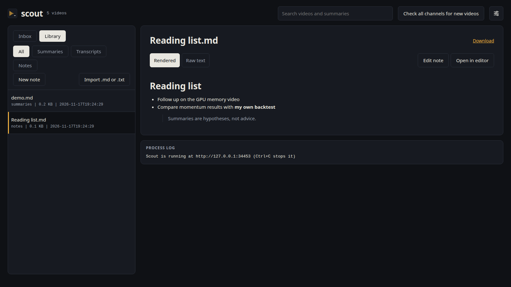
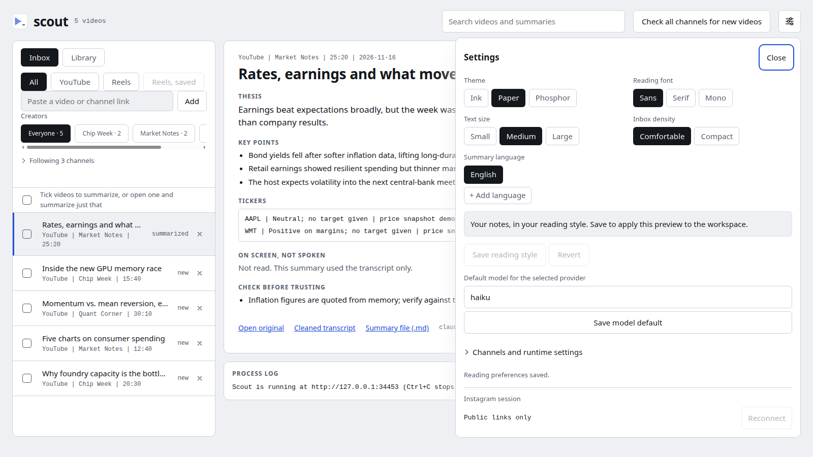

<p align="center">
  
</p>

<h1 align="center">Scout</h1>

<p align="center">
  A private video inbox and file library. Follow YouTube channels, pick the uploads worth your time,
  and read AI summaries, transcripts and your own notes, all stored locally.
</p>

<p align="center">
  
  
  
  
</p>

<p align="center">
  
</p>

> [!NOTE]
> Scout runs the AI CLIs you already pay for (Claude, Codex, Gemini) under your existing subscription.
> Discovery, transcripts and input preparation never call a model. Nothing goes to an AI until you
> press **Summarize**.

## ✨ Features

| | |
|---|---|
| 📥 **Inbox** | Follow YouTube channels, check them for new uploads, filter by creator, remove with undo. |
| 🧠 **Summaries** | Thesis, key points, tickers with price snapshots, and a "check before trusting" list. Brief, Standard, Deep dive or Plain words. |
| 📚 **Library** | Summaries, transcripts and Markdown notes in one place. Rendered or raw, import, edit, download. |
| 🔒 **Isolation** | Every headless run uses an auth-only, disposable config: no hooks, skills, MCP or memory. |
| 🔎 **Search** | Full-text search over saved notes, transcripts and summaries (SQLite FTS5). |
| 🎞️ **Reels + OCR** | Public Reel captions, optional local speech-to-text and on-screen text OCR. |
| 🎨 **Themes** | Ink, Paper and Phosphor, with reading font, size and density settings. |

## 🚀 Quick start

```sh
python3 -m venv .venv
.venv/bin/python -m pip install -r requirements.txt
./scout --desktop --port 0     # native window
./install-desktop.sh           # add Scout to the app grid with its icon (--uninstall removes it)
```

Browser mode: run `./scout` and open **http://127.0.0.1:8765**. `--no-browser` skips opening a
browser, and `--port 0` picks a free port. Both modes share the same backend and UI.

Log in to each CLI in your terminal first. Scout never performs a subscription login itself.

## 🧭 How to use it

1. **Follow channels.** Open **Following** and add a channel by its link, or paste a channel link
   into the video field. You can rename a channel, check only that one, or untick it to skip it.
2. **Check for new videos.** This gets the newest uploads, or the last N days, up to N per channel,
   and makes no model calls. Tick **Check for new videos when Scout opens** to run it on launch.
3. **Pick videos.** Tick rows in the inbox, or open one and choose **Summarize just this video**.
   Removed videos (× on a row, Undo for 8 s) are not brought back by later checks.
4. **Choose the engine.** Pick **Claude / Codex / Gemini** and a model. Leave the model blank to use
   the CLI default. Choose a **Summary length** and **What the AI reads**.
5. **Prepare (free), then Summarize.** Prepare downloads transcripts and shows word counts, cache
   hits and how many model calls the run will make. Identical inputs reuse cached summaries. If part
   of a batch fails, only the failed videos need another model call.

<p align="center">
  
</p>

**Library** lists every summary, transcript and note, including files with no inbox record. You can
switch between **Rendered** and **Raw text**, create or import `.md`/`.txt` notes, edit them in the
app or open them in your editor. The Markdown renderer covers headings, lists, code, blockquotes and
safe links. It escapes raw HTML, never loads remote images and is not a full CommonMark implementation.

## ⚙️ Settings

<p align="center">
  
</p>

- **Theme** applies immediately. **Font, size and density** only change the preview until you press
  **Save reading style**. **Revert** throws away unsaved changes.
- **Summary language:** English is built in. You can add a custom language (letters, spaces and
  hyphens). The summary keeps English headings and writes the content in that language.
- **Default model** is saved per provider. **Channels and runtime settings** is a JSON editor that
  checks your input before saving.
- On first run Scout copies `settings.example.json` to `settings.json`. Git ignores that file.

## 🖥️ Desktop

Desktop mode targets **Ubuntu with GTK3/WebKit2**. The window is frameless with built-in
minimize/maximize/close buttons. Drag it by the Scout logo and resize it from the lower-right corner.
Import and download use native file dialogs. Ctrl+R/F5 reloads and Ctrl+W closes the window. After
changing the backend or window code, restart any running Scout process.
macOS and Windows desktop modes are not implemented. See [desktop options](docs/DESKTOP.md).

## 🔒 Headless isolation

Every summary runs with a throwaway configuration. It gets only the auth files it needs, with no
user hooks, Claude-Mem capture, coding skills or MCP. Nothing in the app can turn configured context
back on for a headless run.

- **Claude:** safe mode, empty tool set and settings sources, no MCP/skills/session persistence,
  hooks and auto-memory explicitly off, auth-only config directory.
- **Codex:** auth-only home, ephemeral execution, no user config, rules or project documents.
  Hooks, plugins, skill discovery and shell/web/apps/browser/image features are disabled, and a
  minimal summarizer prompt replaces the coding instructions. This does not guarantee that the CLI
  exposes no built-in tools at all.
- **Gemini:** auth-only home, empty core-tool allowlist, hooks/skills/MCP/auto-memory/extensions
  disabled, minimal system instructions. Temporary session data is deleted when the run finishes.

API-key and cloud-routing environment variables are removed, and Codex API-key credentials are
refused. Each engine process group has a timeout (`engine_timeout`, 180 s by default) and is not
retried automatically. Managed enterprise policies and external observers are outside what Scout
can isolate.

**Open AI in a terminal** is a separate, explicit action. **Isolated** uses the restricted session.
**My CLI setup** uses your own configuration, tools, hooks, skills and memory, which can use more
context and quota. Answers from the terminal are not imported into Scout. GNOME Terminal and xterm
are supported.

## 🎞️ Optional: Reels, speech-to-text and OCR

Scout never reads browser cookies or logs in to Instagram. It tries public captions first, and links
that need a login fail with a clear error. For speech-to-text when there are no captions:

```sh
.venv/bin/python -m pip install -r requirements-media.txt
```

Set `whisper_model_path` to a local CTranslate2 model, ideally under `.venv/models/`. Scout runs it on
the CPU (int8 with VAD) and never downloads model weights. For audio conversion and OCR, put `ffmpeg`
and `tesseract` in `.venv/bin/` (set `TESSDATA_PREFIX` if needed). Scout installs no system packages.

**Spoken + on-screen text** downloads the video and sends OCR'd text to the model, not images. It
samples at most 12 frames. Downloads ask for a 150 MB size cap, which yt-dlp cannot enforce on
streams of unknown size, and each media command times out after 120 s. If one input mode fails,
Scout does not silently switch to another. STT and OCR have not been tested end to end here.

> [!IMPORTANT]
> Ticker prices are snapshots taken when the summary was made, not live quotes, and cached summaries
> keep their original prices. A mention in a video is not a forecast, and Scout does no trading.

## 🗂️ Project layout

```text
src/scout/
  app.py           HTTP endpoints, discovery/preparation/summary jobs, launcher
  config.py        validated settings and model preferences
  engines.py       auth-only CLI sessions, execution and terminal launching
  library.py       constrained note/file operations
  media.py         public Reel captions/STT and capped frame OCR
  pipeline.py      YouTube, VTT and price helpers
  search.py        disposable SQLite FTS5 index of saved files
  desktop.py       Ubuntu GTK/WebKit shell, native file/window actions
  web/             markup, styles and the app/settings/library/desktop controllers
assets/icons/      app icon (SVG + PNG sizes)
scout              launcher using .venv
settings.example.json   tracked defaults; settings.json is personal and ignored
notes/ summaries/ transcripts/   your local files
.cache/            summary cache and rebuildable search index
```

Runtime data and `.venv/` are ignored by Git. Deleting `.cache/search.sqlite3` rebuilds the search
index on the next query.

## ✅ Verify

```sh
./scout --doctor
./scout --selftest
.venv/bin/python -m unittest discover -s tests -v
node tests/test_ui.cjs
node tests/test_settings_ui.cjs
node tests/test_markdown.cjs
node tests/e2e_browser.mjs   # headless Chromium on a throwaway copy; no model calls, never touches your inbox
```

Live engine checks use a little subscription quota and keep isolation on:

```sh
./scout --test-engine claude --model haiku
./scout --test-engine codex
./scout --test-engine gemini --model flash
```

> [!WARNING]
> No provider has completed a live summary through these adapters inside the restricted sandbox.
> The desktop launch and reading preview have been confirmed on a real desktop. The latest Save flow
> and frameless controls still need checking. See [validation](docs/VALIDATION.md) and the
> [design audit](docs/DESIGN-AUDIT.md) for what has been tested and what is still open.

Screenshots in `docs/screenshots/` use made-up demo data.
